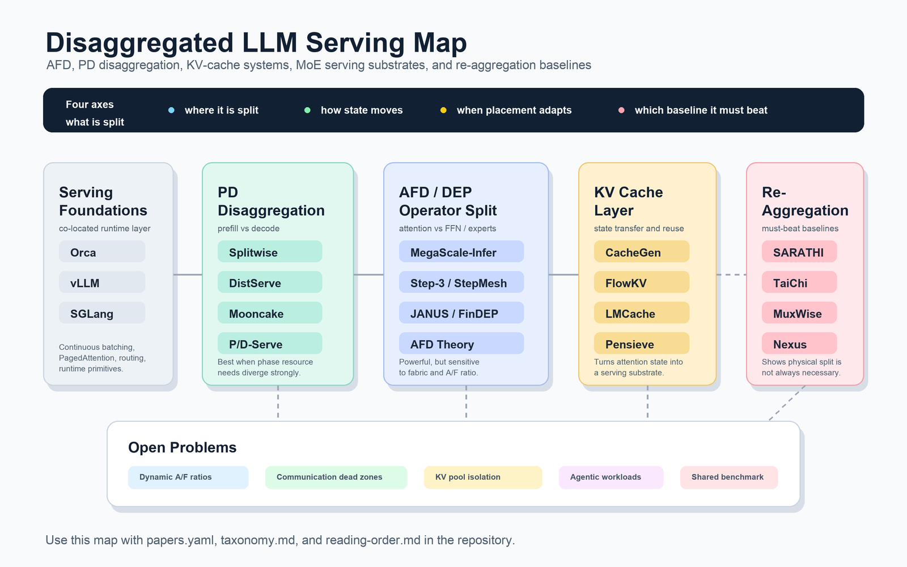

# Awesome AFD and Disaggregated LLM Serving

A curated research map and practical starting point for disaggregated large
language model serving: what to split, when it pays off, and what you can run.

**73 catalog entries · 10 topic groups · source review: October 13, 2026**

[Browse the full catalog](docs/catalog.md) · [Find runnable systems](docs/systems.md) ·
[Build a first experiment](docs/practical-guide.md) · [Compare systems fairly](docs/evaluation.md)

The scope covers prefill–decode (PD), attention–FFN (AFD), disaggregated expert
parallelism (DEP), KV-cache transfer and reuse, multimodal encode–prefill–decode
(EPD), and strong colocated alternatives. Adjacent MoE, hardware, energy, and
simulation work is included when it changes a disaggregation decision.



## Start Here

- **Learning PD:** [DistServe](https://arxiv.org/abs/2401.09670) →
  [Splitwise](https://arxiv.org/abs/2311.18677) → [Mooncake](https://arxiv.org/abs/2407.00079).
- **Learning AFD / DEP:** [MegaScale-Infer](https://arxiv.org/abs/2504.02263) →
  [Step-3](https://arxiv.org/abs/2507.19427) → [AFD challenges](https://arxiv.org/abs/2602.09721).
- **Checking whether splitting wins:** [Sarathi-Serve](https://arxiv.org/abs/2403.02310),
  [TaiChi](https://arxiv.org/abs/2508.01989), and [Helix](https://arxiv.org/abs/2507.07120)
  cover different alternatives; [AFD-Ledger](https://arxiv.org/abs/2608.04502)
  compares provisioned AFD and collocated deployments under matched budgets.
- **Implementing PD:** use the [runtime and transport directory](docs/systems.md)
  and [practical guide](docs/practical-guide.md), then the official guide for your release.
- **Writing related work:** use the [linked catalog with scope notes](docs/catalog.md),
  [taxonomy](docs/taxonomy.md), and [reading paths](docs/reading-order.md).
- **Designing experiments:** use [traces, tools, metrics, and baselines](docs/evaluation.md).

## Recent Additions Worth Reading

These are selected additions, not a claim to cover every paper or rank impact.
Recent arXiv entries remain labeled as preprints unless publication is verified.

- **Elastic PD:** [DynaServe](https://arxiv.org/abs/2504.09285),
  [prefill deflection](https://arxiv.org/abs/2607.02043), and
  [FluidPD](https://arxiv.org/abs/2610.06917) address underutilized pools and changing demand.
- **AFD decisions:** [How Far Can Disaggregation Go?](https://arxiv.org/abs/2605.28302)
  and [AFD-Ledger](https://arxiv.org/abs/2608.04502) strengthen the design-space and provisioning comparison.
- **KV/network bottlenecks:** [NetKV](https://arxiv.org/abs/2606.03910),
  [SmartGen](https://arxiv.org/abs/2607.28150), [SpectrumKV](https://arxiv.org/abs/2606.08635),
  and [Lynx](https://arxiv.org/abs/2607.01831) study routing, selective transfer, and precision.
- **Hardware and power:** [subquadratic disaggregation](https://arxiv.org/abs/2609.13134),
  [power-aware PD provisioning](https://arxiv.org/abs/2609.24639),
  [disaggregated quantization](https://arxiv.org/abs/2609.26333), and
  [DynaCore](https://arxiv.org/abs/2610.07443) broaden the hardware design space.
- **Multimodal:** [EPD disaggregation](https://arxiv.org/abs/2501.05460),
  [vLLM-Omni](https://arxiv.org/abs/2602.02204), [EPD-Serve on Ascend](https://arxiv.org/abs/2601.11590),
  and [EAServe](https://arxiv.org/abs/2609.31551) add encode and other stage boundaries.
- **Engineering:** [Dynamo](https://github.com/ai-dynamo/dynamo),
  [NIXL](https://github.com/ai-dynamo/nixl), [llm-d](https://github.com/llm-d/llm-d),
  [TensorRT-LLM](https://github.com/NVIDIA/TensorRT-LLM), and
  [AIPerf](https://github.com/ai-dynamo/aiperf) now have explicit artifact entries.

## Browse by Topic

- [PD disaggregation and elasticity](docs/catalog.md#pd-disaggregation)
- [AFD and expert disaggregation](docs/catalog.md#afd)
- [AFD provisioning and boundaries](docs/catalog.md#afd-theory)
- [Aggregation, multiplexing, and temporal alternatives](docs/catalog.md#reaggregation)
- [KV-cache transfer, storage, and reuse](docs/catalog.md#kv-cache)
- [MoE serving substrates](docs/catalog.md#moe-serving)
- [Serving foundations and engineering frameworks](docs/catalog.md#serving-foundation)
- [Hardware, heterogeneity, quantization, and energy](docs/catalog.md#hardware-energy)
- [Traces, simulators, and evaluation](docs/catalog.md#evaluation)
- [Multimodal / EPD](docs/catalog.md#multimodal)

## Use the Catalog Locally

Requires **Python 3.10+**, with no third-party dependencies. Run from the repository root.

```bash
python3 scripts/search_papers.py --tag AFD
python3 scripts/search_papers.py --category kv-cache --code
python3 scripts/search_papers.py --year 2026 --json
python3 scripts/search_papers.py "elastic"
```

Text search covers titles, tags, contribution, and scope notes. Filters combine
with AND; tag matching is exact and case-insensitive. Code availability means a
verified author/project link, not a tested installation or complete reproduction.
Use [data/papers.json](data/papers.json) for programmatic access.

## Repository Map

- [papers.yaml](papers.yaml): source of truth for paper and artifact metadata.
- [docs/catalog.md](docs/catalog.md): generated links, code, contribution, and scope for every entry.
- [docs/systems.md](docs/systems.md): runtimes, frameworks, transfer libraries, and research artifacts.
- [docs/practical-guide.md](docs/practical-guide.md): deployment choices and a first PD experiment.
- [docs/evaluation.md](docs/evaluation.md): workloads, metrics, baselines, and experiment reporting.
- [docs/taxonomy.md](docs/taxonomy.md): what, where, how, and when to split.
- [docs/reading-order.md](docs/reading-order.md): learning and implementation paths.
- [docs/open-problems.md](docs/open-problems.md): research questions situated against existing work.
- [docs/impact-ranking.md](docs/impact-ranking.md): editorial reading roles, not citation rankings.
- [docs/timeline.md](docs/timeline.md): preprint and publication milestones.
- [docs/glossary.md](docs/glossary.md): serving terms and measurement definitions.
- [docs/sources.md](docs/sources.md): verification policy, review boundaries, and maintenance notes.

## Contribute and Maintain

Add or correct a record in `papers.yaml`, attach a primary source, and explain
both its contribution and its scope. See [CONTRIBUTING.md](CONTRIBUTING.md).

```bash
python3 scripts/validate_papers.py
python3 scripts/generate_tables.py --write
python3 scripts/generate_tables.py --check
python3 -m unittest discover -s tests -v
```

CI checks record syntax, duplicate identifiers, generated-file freshness, and
maintenance-command behavior. It does not reproduce papers or prove URL availability.

## Inclusion and Source Policy

Include work that affects phase/operator/state/expert separation, its alternatives,
implementation, or evaluation. General quantization, speculative decoding, and
model architecture papers need an explicit connection to these decisions.

`status` describes an editorial reading role. `artifact_type` distinguishes papers,
libraries, frameworks, and benchmark tools. `verified` is a source metadata check
date. A `null` code field means an associated artifact was not verified in the
current pass. See the [source policy](docs/sources.md) before interpreting a label.

## Related Repositories

- [Awesome LLM Inference](https://github.com/xlite-dev/Awesome-LLM-Inference)
- [Awesome LLM Inference Serving](https://github.com/zenrran4nlp/Awesome-LLM-Inference-Serving)
- [Awesome KV Cache Optimization](https://github.com/jjiantong/Awesome-KV-Cache-Optimization)
- [Awesome MoE Inference](https://github.com/MoE-Inf/awesome-moe-inference)
- [Awesome Mixture of Experts Papers](https://github.com/codecaution/Awesome-Mixture-of-Experts-Papers)

## Citation

If this map helps your research, cite the repository using [CITATION.cff](CITATION.cff).
Cite the original papers for their contributions and results.
