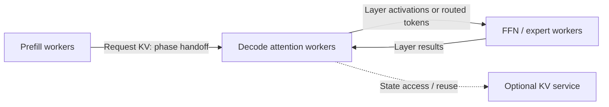

# What Exactly Is Being Disaggregated?

This guide adapts the boundary-first framework in the author-provided draft
*Disaggregated LLM Serving: A Survey and Taxonomy of Prefill–Decode and
Attention–FFN Separation* (Chenxu Niu). The manuscript's discovery catalog and
source-located analysis informed this update. The definitions below are an
editorial framework, not a universal standard or a new audit of every system.

## A Structural Test Before a Performance Claim

A communication edge alone does not establish a service-level split. Ask:

1. **Capacity:** can the roles receive independently allocated capacity at a
   stated timescale, such as separate workers, device groups, or GPU partitions?
2. **Interface/state contract:** what crosses or is shared, who owns it, and who
   may read, mutate, retain, and reclaim it?
3. **Control:** can scheduling/routing and sizing address the roles separately,
   rather than treating them as a fixed jointly provisioned gang?

Physical copying is one implementation. A shared memory view, reference,
ownership transfer, or remotely accessible state service may also form an
interface. Conversely, expert parallelism or tensor/pipeline parallelism can
communicate extensively without exposing independently controlled service roles.

Examples illustrate different contracts:

- [DistServe](catalog.md#distserve): phase boundary with request KV handoff.
- [Mooncake](catalog.md#mooncake): phase placement coupled to cache/state services.
- [semi-PD](catalog.md#semi-pd): phase-wise computation with unified storage.
- [Nexus](catalog.md#nexus) and [RAPID-Serve](catalog.md#rapid-serve): intra-device
  organizations whose shared-resource accounting differs from inter-node PD.
- [MegaScale-Infer](catalog.md#megascale-infer): repeated attention/expert exchange.

## Four Operator Boundaries That Need Different Comparisons

| Boundary | What stays together | What crosses | Reading anchors |
|---|---|---|---|
| Full attention ↔ FFN/expert | Attention-side projections, core attention, and KV; FFN/expert work on the other side | Hidden states / routed activations and returned outputs at layer boundaries | [MegaScale-Infer](catalog.md#megascale-infer), [FastAFD](catalog.md#fastafd), [Step-3](catalog.md#step3) |
| Core attention ↔ weight path | KV/core attention on one side; projections and FFN on the other | Queries/KV updates and attention outputs, according to the interface | [Lamina](catalog.md#lamina), [KernelFlume](catalog.md#kernelflume), [Glinthawk](catalog.md#glinthawk) |
| Borrowed attention | Core attention uses spare capacity of workers that retain another role | Attention inputs/results plus state placement metadata | [Adrenaline](catalog.md#adrenaline), [Weaver](catalog.md#weaver), [OmniServe](catalog.md#omniserve) |
| Expert service | Request state, projections, router, and cache remain with clients; experts expose an independent service | Routed token activations and expert results | [EaaS](catalog.md#expert-as-a-service), [Remoe](catalog.md#remoe), [FaaSMoE](catalog.md#faasmoe) |

Subtype labels summarize the described boundary and are not proof that every
capacity/control/ownership property was reported. When projection placement or
another contract detail is unclear, record that uncertainty. Do not force a
core-attention result into the byte or provisioning model of full-attention AFD.

The diagram is conceptual: it does not specify where weights, projections,
routers, shared experts, or encoder stages reside. [AFlex](catalog.md#aflex),
[ExpertPlex](catalog.md#expertplex), and [HexGen-3](catalog.md#hexgen-3) realize
composite organizations with different sharing and control choices.

## Describe a Deployment on Five Planes

- **Boundary/subtype:** phase, full/core/borrowed attention, expert service, another stage, or composition.
- **Object/state contract:** KV, activations, weights, routing metadata; local ownership, copy, shared view, pooled service, or replica.
- **Placement/provisioning:** partitions, GPUs, nodes, racks; allocation granularity, role ratio, and per-role parallelism.
- **Data path/cadence:** transport, direction, granularity, overlap, and how often an exchange occurs.
- **Control timescale:** offline search, request routing, iteration scheduling, migration, or slower resizing.

Write the timescale alongside the word “dynamic.” A per-request route choice,
a role flip, a weight migration, and a five-minute replanning loop solve
different control problems.

The four-axis [taxonomy](taxonomy.md) is a compact navigation view. These five
planes expand it by separating state ownership from data-path mechanics.

## Operational Independence Is a Separate Overlay

Assess these properties separately from whether a structural boundary exists:

- **Progress:** can one role continue serving while the other is delayed?
- **Lifecycle scaling:** can one role's capacity or assignment change while its
  peer continues serving?
- **Failure/recovery:** can a failure and recovery be contained while healthy
  roles continue serving?

A demand-driven resize, a role reassignment, and replacement after failure are
different events. Recovery evidence alone does not demonstrate demand-driven
elasticity. Pipeline overlap alone does not demonstrate independent progress.

[Tarragon](catalog.md#tarragon) is a resilience anchor;
[OpScale](catalog.md#opscale), [AFlex](catalog.md#aflex), and
[FluidPD](catalog.md#fluidpd) address different provisioning/adaptation mechanisms.
Read the actual reported event, workload, and continuity semantics rather than
inferring properties from an autoscaler component or a configuration flag.

**Not reported is not the same as absent.** Use explicit unknowns when a source
omits achieved bandwidth, failure tests, drain behavior, or state ownership.

## A Useful Reporting Contract

For each proposed split, document capacity, interface, control, state lifetime,
transfer bytes/cadence, achieved bandwidth, role utilization, and all reserved
resources. Report the actual evidence type:

- Measured live system or microbenchmark, with its scope.
- Simulation calibrated against specified measurements.
- Analytical model or projected future hardware.
- Documented runtime contract without independent performance evidence.

A single paper can contain several evidence types. For example, FastAFD's
[technical report](https://haoailab.com/blogs/fastafd/) separates measured
steady-state decode from projected future hardware. KernelFlume separates
[small-model live tests from larger-scale simulation](https://arxiv.org/abs/2606.29207).
Use [evaluation.md](evaluation.md) to connect these contracts to fair comparisons.
